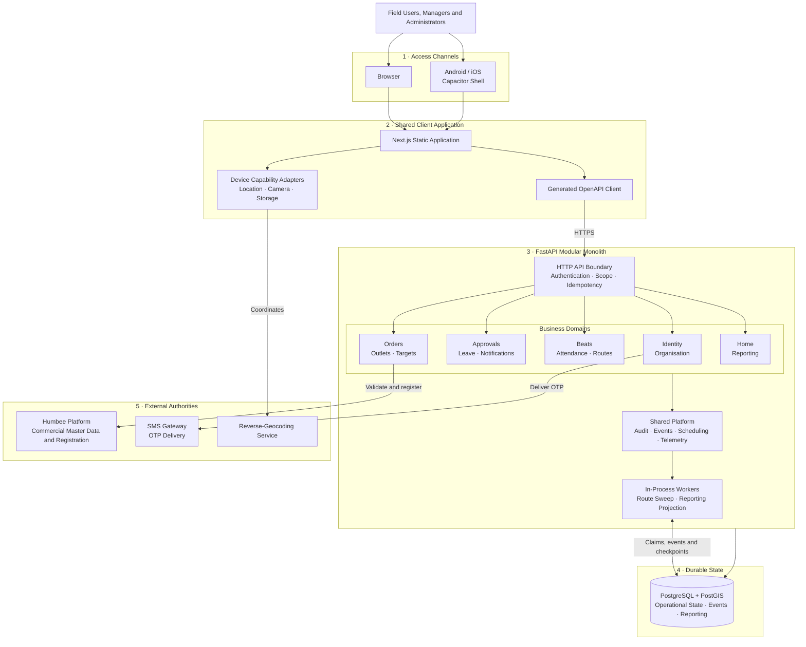
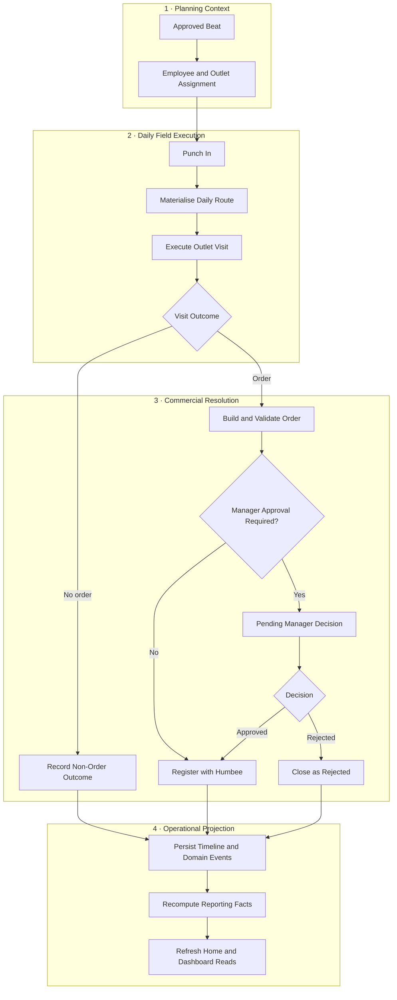
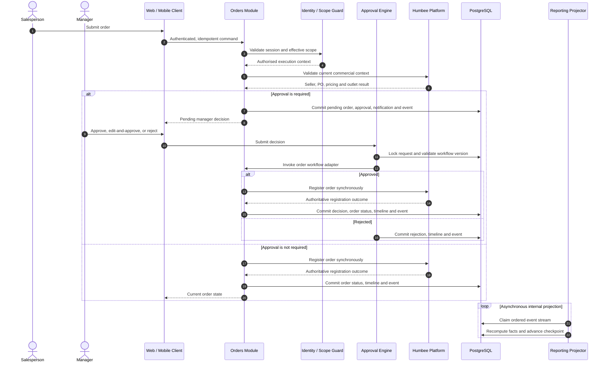

# Humbee SFA — Architecture and Runtime Flow

## Document Scope

This document is a technical orientation to the deployed codebase. It identifies runtime boundaries, module connectivity, and principal event flows without reproducing endpoint catalogues, payload schemas, domain algorithms, or implementation-level design research. The source code and generated OpenAPI contract remain authoritative for implementation details.

## System Context

Humbee SFA is implemented as a **modular monolith** with a statically exported web client, a native mobile shell, a FastAPI application boundary, and PostgreSQL/PostGIS persistence. Commercial master data and downstream order registration remain delegated to the external Humbee platform.

## Module Topology

### Client delivery

- `apps/web` contains the production user interface, role-aware navigation, client-side state, API integration, and browser/native capability abstraction.
- `apps/mobile` packages the same exported web application through Capacitor; it is a delivery shell rather than a second business application.
- Shared design-system and generated contract packages provide presentation consistency and compile-time API alignment.

### Application domains

- **Identity and Organisation** — OTP authentication, device/session lifecycle, workforce hierarchy, geography, and scope resolution.
- **Approvals, Leave and Notifications** — reusable approval orchestration, decision history, leave workflow, and database-backed user notifications.
- **Beats, Attendance and Routes** — field allocation, presence evidence, daily route materialisation, visit execution, and outcome capture.
- **Orders, Outlets and Targets** — commercial workflow, local outlet projection, onboarding/verification, goals, and lead tracking.
- **Home and Reporting** — composite operational reads and event-derived analytical projections.

Each domain is internally partitioned into HTTP routing, service orchestration, persistence, and schema/model concerns. Cross-domain behaviour is coordinated through public service interfaces and registered workflow adapters rather than direct client-side composition.

### Shared platform

The backend platform layer centralises security dependencies, transaction/session handling, auditing, idempotency, rate limiting, runtime configuration, feature flags, domain-event persistence, scheduled execution, and request telemetry.

## Connectivity Invariants

1. **Contract boundary:** FastAPI generates the OpenAPI description used to generate the TypeScript client. Contract-drift checks protect client/server alignment.
2. **Identity boundary:** Authenticated requests require both valid token claims and a valid persisted application session.
3. **Scope boundary:** Organisation hierarchy resolves effective access as self, managed-tree, or organisation scope before domain reads and commands execute.
4. **Workflow boundary:** Beat, leave, order, and outlet decisions participate in one polymorphic approval engine through domain-specific adapters.
5. **Transaction boundary:** Domain state, decision history, audit records, notifications, and domain-event records are persisted through coordinated database transactions.
6. **Integration boundary:** Humbee-specific transport and response semantics remain isolated behind backend integration adapters. Humbee is authoritative for relevant commercial entities and registration outcomes.
7. **Projection boundary:** Reporting facts are recomputed from ordered, durable domain events; PostgreSQL offsets and advisory locks coordinate projector execution.

## Principal Operational Flow

The normal field-execution chain is:

## Order Approval and Event Sequence

Humbee order registration is currently synchronous. Application events are durable database records used for internal projection; they do not imply an external message broker. In-app notifications are persisted and client-polled rather than delivered through a push channel.

## Data and Runtime Characteristics

- PostgreSQL is the durable system of record for SFA operational state, sessions, workflow history, notifications, audit records, idempotency, rate limits, domain events, scheduler claims, and reporting facts.
- PostGIS supports geospatial field-execution data; `ltree` supports organisational hierarchy traversal.
- Reporting projection and route-sweep processes run with the API runtime. PostgreSQL advisory locks provide single-leader execution when multiple API instances are active.
- The web application is built as a static export and can be served independently from the API container.
- Structured request logging and correlation identifiers provide the implemented observability baseline.

## Codebase Orientation

- `apps/api/src/humbee_sfa/main.py` — application composition and runtime registration.
- `apps/api/src/humbee_sfa/modules/` — business-domain modules.
- `apps/api/src/humbee_sfa/integration/humbee/` — Humbee transport boundary.
- `apps/api/src/humbee_sfa/platform/` — cross-cutting runtime capabilities.
- `apps/api/db/bootstrap/` — database extensions and baseline schema.
- `apps/web/src/features/` — feature-specific client modules.
- `apps/web/src/shared/` — API, authentication, state, and device-capability infrastructure.
- `apps/mobile/` — native packaging and platform configuration.
- `packages/` — shared design and generated contract surfaces.

## Maintenance Guidance

Changes should preserve domain ownership, avoid bypassing scope resolution, and keep Humbee-specific behaviour within the integration boundary. Any API modification should regenerate the OpenAPI/client artefacts and pass contract-drift validation. Changes affecting workflow state should be evaluated across the originating domain, approval adapter, notification trail, audit record, and reporting projection as one consistency unit.
