# Event Flow & KPI Dependencies

> **Status: DRAFT for review.** Derived from the backend code in `apps/api/src/humbee_sfa/` (behaviour verified in code, not from older docs). Where this disagrees with `Humbee/docs/features/M11-reporting-and-dashboards.md`, the code wins; the differences are listed in [§9](#9-findings-worth-knowing-before-you-trust-a-number).

This doc answers four questions:

1. What are the **two background jobs**, and exactly what does each one do? (§2, §3)
2. Which **events** exist, and which ones does the reporting job actually process? (§4, §5)
3. How does an event travel for each **business case** (punch, leave, visit, order, lead, org change, day close)? (§6)
4. Which **KPI** depends on which **event** (and which KPIs depend on no event at all)? (§7)

All paths below are relative to `apps/api/src/humbee_sfa/`.

---

## 1. The big picture

There are two independent background workers, started in the FastAPI lifespan ([main.py](apps/api/src/humbee_sfa/main.py), skipped when `environment == "test"`). They do different jobs and never call each other:

| | **Job A — End-of-Day sweep** | **Job B — Reporting projector** |
| --- | --- | --- |
| Class | `EndOfDaySweepWorker` ([routes/sweep_worker.py](apps/api/src/humbee_sfa/modules/routes/sweep_worker.py)) | `ReportingProjectorWorker` ([reporting/projector_worker.py](apps/api/src/humbee_sfa/modules/reporting/projector_worker.py)) |
| Purpose | **Closes yesterday's route day**: marks un-visited stops `missed`, auto-closes visits that already have orders, closes plans | **Folds domain events into reporting fact tables** that KPI cards read |
| Reads | Route tables (`routes_visits`, `routes_plans`, …) | `platform_domain_events` (the event log) |
| Writes | Route tables + (for auto-closed visits) one `visit_completed` event | `dim_employee`, `fact_employee_day`, `fact_employee_outlet_day`, `fact_employee_manufacturer_day`, `projector_offset`, `event_quarantine` |
| Cadence | Polls every **30 s**; a business date becomes due **5 min after IST midnight** | Every `reporting_projector_interval_seconds`: **21 600 s (6 h)** default / prod, **300 s (5 min)** on sbx |
| Idempotency | Advisory lock **+** one claimed row per `(tenant, job, business_date)` in `platform_sweep_runs` | Advisory lock only (it must run many times a day) |

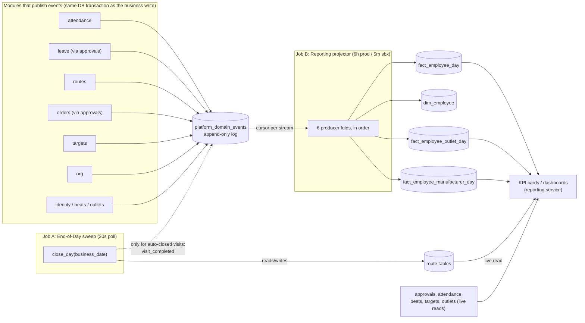

**Key idea:** KPIs come from **two sources**. *Rollup* KPIs are only as fresh as Job B's last tick. *Live* KPIs query the owning module's tables at request time and don't depend on Job B at all (but Job A changes the route rows they read).

---

## 2. Job A — End-of-Day sweep

Files: [sweep_worker.py](apps/api/src/humbee_sfa/modules/routes/sweep_worker.py) (when), [sweep.py](apps/api/src/humbee_sfa/modules/routes/sweep.py) (job body), [routes/service.py `close_day`](apps/api/src/humbee_sfa/modules/routes/service.py) (what), [platform/scheduler.py](apps/api/src/humbee_sfa/platform/scheduler.py) (`SupervisedJobRunner`: locking + run claiming).

### 2.1 When does a day get swept?

```
due_date = business_date(now − route_sweep_grace_minutes[5]) − 1 day      # day_boundary_hour_ist = 0
```

So business date **D** becomes due at **00:05 IST on D+1**. Each tick (every 30 s) the worker sweeps:

- every date in the **last 7 days ending at `due_date`** that has **no `succeeded` run**, **plus**
- any earlier date that **still holds an open visit or plan** (`scheduled` / `in_progress`), and those are **re-run even if a prior run succeeded** (`rerun_succeeded=True`), so work that syncs late lands on the day it happened.

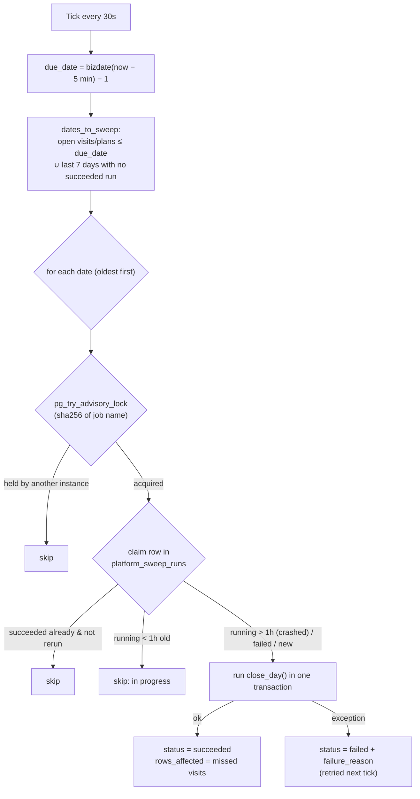

The same job can be forced manually via the operator-only endpoint `trigger_end_of_day_sweep` ([routes/router.py](apps/api/src/humbee_sfa/modules/routes/router.py)).

### 2.2 What `close_day(business_date)` does

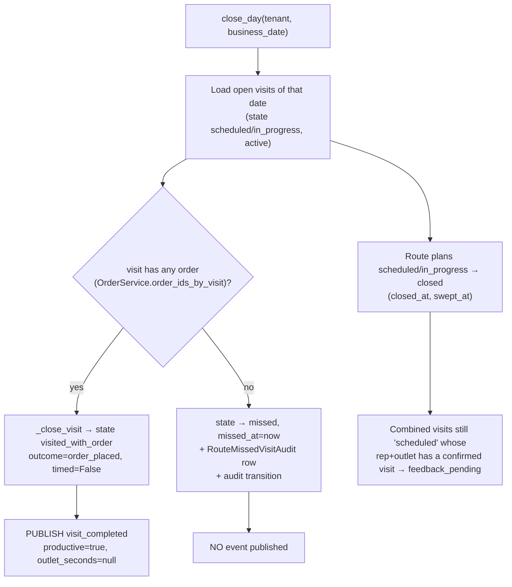

| Outcome | Route table effect | Event emitted | Reaches reporting facts? |
| --- | --- | --- | --- |
| Open visit **with** an order | `visited_with_order` | `visit_completed` (`productive=true`, `outlet_seconds=null`) | Yes, on Job B's next tick |
| Open visit **without** an order | `missed` (+ audit row) | **none** | **No** — no fact column is written for missed visits |
| Open plan | `closed` | none | No (planned count was already set by `route_plan_saved`) |
| Scheduled combined visit with a confirmed visit | `feedback_pending` | none | No |

> Job A is **not** a consumer of the event log. It reads/writes route tables directly. Its only link to Job B is the `visit_completed` events it emits for auto-closed productive visits.

---

## 3. Job B — Reporting projector

Files: [projector_worker.py](apps/api/src/humbee_sfa/modules/reporting/projector_worker.py) (loop + lock), [projector_job.py](apps/api/src/humbee_sfa/modules/reporting/projector_job.py) (stream order), [projector.py](apps/api/src/humbee_sfa/modules/reporting/projector.py) (engine), [producers/](apps/api/src/humbee_sfa/modules/reporting/producers/) (per-stream fold logic), [dim_employee_sync.py](apps/api/src/humbee_sfa/modules/reporting/dim_employee_sync.py).

### 3.1 One tick

The first tick runs **immediately at startup**, then every interval. One process wins `pg_try_advisory_lock("reporting_projector")`; the rest skip.

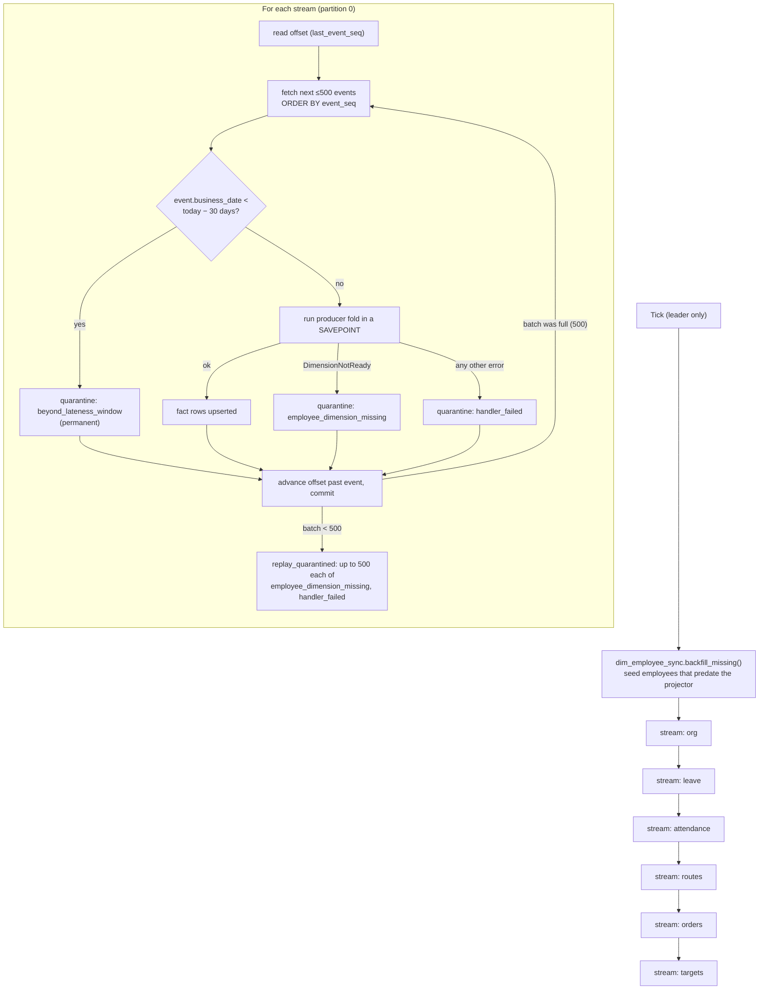

Why the stream order matters: `org` runs **first** because every other producer's write to `fact_employee_day` needs a current `dim_employee` row; without it the event is quarantined as `employee_dimension_missing` and healed on a later tick once the dimension exists.

### 3.2 Rules that shape every number

| Rule | Consequence |
| --- | --- |
| **Recompute, never increment** | Each fold *sets* the columns from the event/day's state; replaying an event any number of times converges to the same row. |
| **At-least-once + offset** | Offset advances past every event whether applied or quarantined. A quarantined event is **never retried automatically** — only `replay_quarantined` (for `employee_dimension_missing` and `handler_failed`). |
| **Lateness window = 30 days** | Events whose `business_date` is older than `today − 30d` are quarantined permanently (`beyond_lateness_window`) — a month is never silently rewritten. |
| **Business date** | IST day, boundary hour 0 (`day_boundary_hour_ist`). |
| **One bad event can't stall a stream** | Each fold is wrapped in a savepoint; failure rolls back only that event. |
| **Ownership of columns** | Each producer only writes columns its stream owns, so two producers on the same row don't clobber each other. |

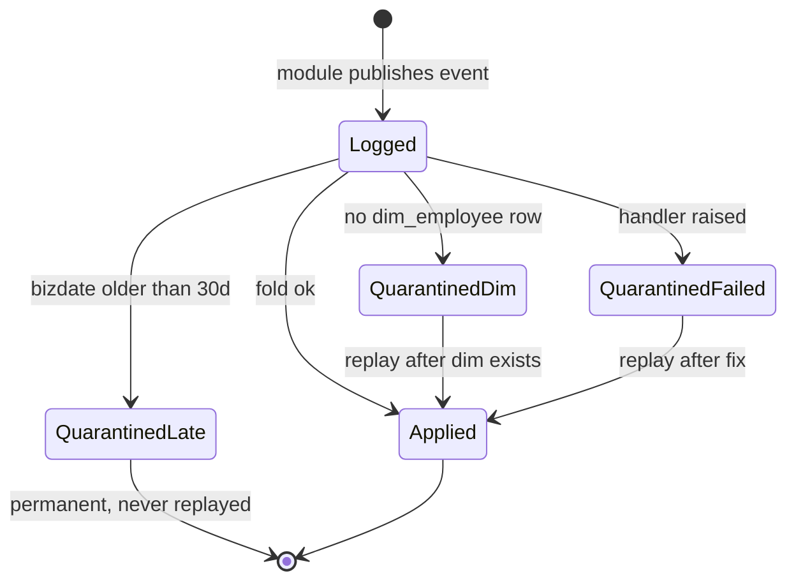

---

## 4. Event catalogue — what is published, and what is processed

Every domain event is a row in `platform_domain_events` with a `stream`, `event_type`, `business_date` (from `occurred_at`, IST) and a per-stream monotonically increasing `event_seq` ([platform/domain_events.py](apps/api/src/humbee_sfa/platform/domain_events.py)).

### 4.1 Processed by the reporting projector (6 streams, 17 event types)

| Stream | Event type | Published by | Producer fold | Effect |
| --- | --- | --- | --- | --- |
| `org` | `employee_created` / `employee_updated` / `employee_moved` / `employee_deactivated` | `org` ([org/events.py](apps/api/src/humbee_sfa/modules/org/events.py)) | `org_dim_employee_rollup` | Re-reads employee's current state and **versions `dim_employee` (SCD2)** if a tracked field changed. Payload values are not used. |
| `leave` | `leave_granted` / `leave_rejected` / `leave_withdrawn` | `leave` adapter, inside the approvals decision | `leave_rollup` | Sets `is_leave_day` + `leave_type` on **every date in `from_date..to_date`**. |
| `attendance` | `punched_in` | `attendance` ([attendance/events.py](apps/api/src/humbee_sfa/modules/attendance/events.py)) | `attendance_rollup` | `punched_in=true`, `first_punch_in_at`, `is_late_punch_in` |
| `attendance` | `punched_out` | same | same | `punched_in=false`, `last_punch_out_at`, `on_duty_seconds` (= punch-out − first punch-in of that day) |
| `attendance` | `official_work_logged` | same | same | `official_work_seconds` (sum of day's logged durations), `official_work_task_count` (count of day's logged events) |
| `routes` | `visit_completed` | `routes` (`_publish_visit_completed`; also emitted by Job A) | `routes_rollup` | Recomputes the employee-day's visits + outlet-day visits (see §5) |
| `routes` | `route_plan_saved` | `routes` (plan save) | `routes_rollup` | Recomputes `planned_outlets` = Σ `stop_count` of the latest event per distinct plan |
| `orders` | `order_submitted` / `dp_order_approved` / `dp_order_rejected` / `dp_order_withdrawn` | `orders` service + orders approvals adapter | `orders_rollup` | **Event is only a trigger.** Re-reads *all of that employee's orders for the order's date* from `orders` live state and recomputes order columns on all three fact tables. |
| `targets` | `lead_captured` | `targets` service | `targets_rollup` | `leads_captured_count` = live count of that employee's leads that day |

### 4.2 Published but **ignored** by the projector

Safe to publish, no reporting impact today. They sit in the log.

| Stream | Events | Note |
| --- | --- | --- |
| `attendance` | `official_work_started` | No foldable number; the matching `official_work_logged` closes the session. |
| `routes` | `visit_started`, `unplanned_beat_run_started`, `combined_visit_scheduled`, `combined_visit_feedback_submitted` | Payload of the feedback event has no employee/outlet id, so it can't feed any KPI. |
| `targets` | `target_set`, `target_updated`, `target_removed` | Targets are read live from the targets module. |
| `beats` | `beat_*` events (owner reassigned, deactivated, reactivated, adapter events) | |
| `outlets` | `outlet_candidate_approved` / `_rejected` / `_withdrawn` | The `outlets_onboarded_*` fact columns exist but nothing writes them (§9). |
| `identity` | `otp_*`, `session_*`, `logout`, `reauth_succeeded`, `login_blocked_deactivated` | Auth audit stream. |
| `org` (geography) | `geo_scope_assigned` | Not in the org producer's tracked list. |

---

## 5. Event → fact-column map

What each event actually writes. (`FED` = `fact_employee_day`, `FEOD` = `fact_employee_outlet_day`, `FEMD` = `fact_employee_manufacturer_day`.)

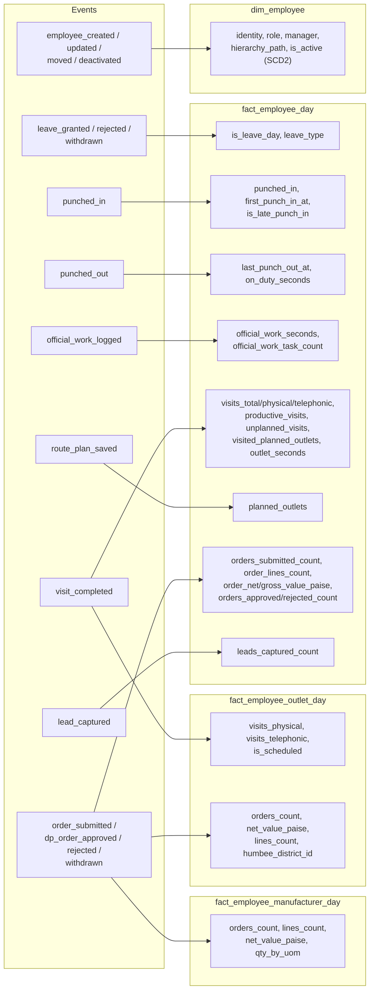

Notes on the order fold ([orders_rollup.py](apps/api/src/humbee_sfa/modules/reporting/producers/orders_rollup.py)):

- Statuses `draft`, `submission_failed`, `cancelled` are never counted.
- **Money and lines count only approved orders** (`approved`, `approved_with_edits`, `dp_creation_pending`, `dp_created`). `orders_submitted_count` counts every non-excluded order (including pending/rejected). Net value currently equals gross (both are `approved_gross_value_paise`).
- Whole-day recompute also **deletes stale FEMD rows** and **zeroes stale FEOD order columns** for manufacturers/outlets the day no longer has.

Notes on the routes fold ([routes_rollup.py](apps/api/src/humbee_sfa/modules/reporting/producers/routes_rollup.py)):

- A visit linked to a stop *after* it closed re-publishes `visit_completed`; the day's visits are the **latest event per visit** (`aggregate_id`).
- `planned` = the visit had a route stop at publish time; `visited_planned_outlets` = distinct outlets among planned visits.
- `outlet_seconds` is `null` for sweep-closed visits (real duration unknown), so it contributes 0.

---

## 6. Case-by-case flows

### 6.1 Punch in / punch out

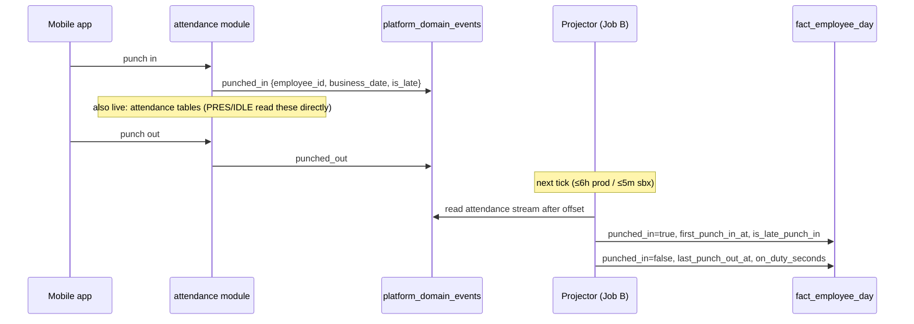

### 6.2 Leave

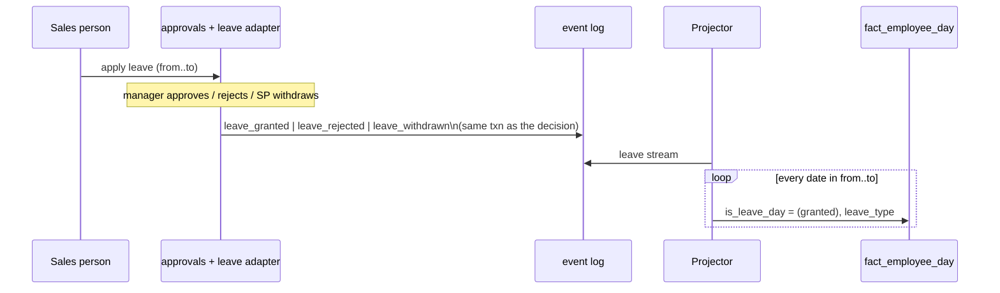

### 6.3 Route plan → visit → order

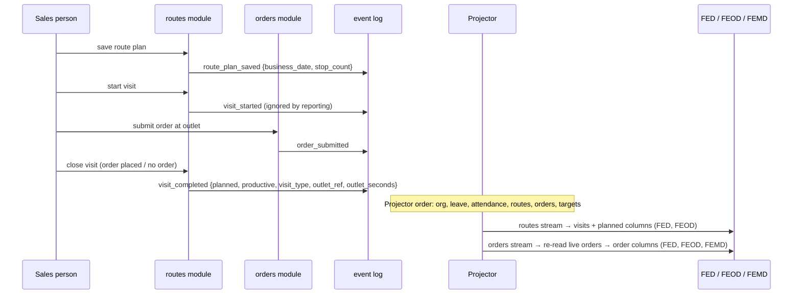

### 6.4 Order approval lifecycle (DP order)

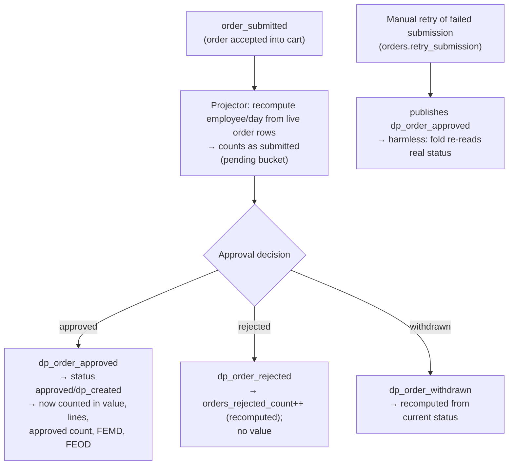

Because the fold always **re-reads current order state**, the exact event type does not decide the numbers — the order's status at tick time does. Even an order from before these events existed folds correctly the moment any later order event arrives.

### 6.5 Lead capture

`targets.capture_lead` → `lead_captured` → `targets_rollup` sets `FED.leads_captured_count` from a live `count_leads_for_employee_day`. (The manager dashboard's *leads* tile, however, reads leads live — see §7.)

### 6.6 Org change (new joiner, transfer, deactivation)

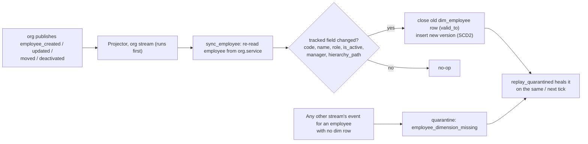

### 6.7 End of day (Job A → Job B)

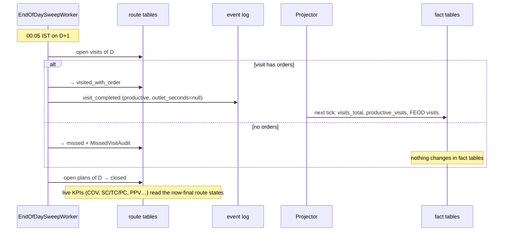

### 6.8 Late / back-dated events

| Situation | What happens |
| --- | --- |
| Offline sync delivers a visit from **3 days ago** | `visit_completed` has the payload `business_date` = 3 days ago → recomputes **that** day's row. Also Job A will re-sweep that date if it still holds open visits. |
| Event older than **30 days** | `beyond_lateness_window` quarantine; never applied. |
| Employee has no `dim_employee` row yet | `employee_dimension_missing` quarantine; healed by replay once the org fold/backfill creates the row. |
| Handler bug | `handler_failed` quarantine with error text; replayable after the fix. |
| Same event delivered twice | Harmless — recompute-not-increment. |

---

## 7. KPI → event dependency

The KPI card system is `GET /reporting/kpi-surfaces/{surface}` ([reporting/service.py](apps/api/src/humbee_sfa/modules/reporting/service.py) `_load_context` / `_build_card`) plus the dashboard endpoints (`get_sp_dashboard_kpis`, `get_manager_dashboard_kpis`, `get_admin_dashboard_kpis`). A code with no live source renders as `—` ("not available yet").

**Legend — source type**
- 🟦 **Rollup**: read from fact tables → depends on events + Job B freshness.
- 🟩 **Live**: read from the owning module's tables at request time → no Job B dependency.
- 🟨 **Mixed**: rollup history + live "today" overlay.

### 7.1 Sales-person KPIs

| Code | Meaning | Src | Reads | Depends on events |
| --- | --- | --- | --- | --- |
| `OV` | Order value booked today | 🟦 | `FED.order_net_value_paise` | `order_submitted`, `dp_order_*` |
| `LPSC` | Lines per sales call | 🟦 | `FED.order_lines_count ÷ FED.productive_visits` | `order_*` **and** `visit_completed` |
| `UTC` / `UTC-D` / `T-UTC` | Unique outlets visited | 🟦 | `FEOD` distinct outlets with `visits_physical+visits_telephonic > 0` | `visit_completed` |
| `ECO/UPC` | Outlets ordered | 🟦 | `FEOD` distinct outlets with `orders_count > 0` | `order_*` |
| `ZO` | Zero-order outlets (visited, never ordered in window) | 🟦 | `FEOD` visited ∖ ordered | `visit_completed`, `order_*` |
| `UCR` / `T-UCR` | Unique conversion (ordered ÷ unique) | 🟦 | `FEOD` | `visit_completed`, `order_*` |
| `OVLP` | Outlets visited by 2+ reps | 🟦 | `FEOD` outlets with ≥2 employees | `visit_completed` |
| `NEW` | Outlets first visited this month | 🟦 | `FEOD` current vs prior month | `visit_completed` |
| `BAD` | Beat adherence (planned outlets visited ÷ planned) | 🟦 | `FED.visited_planned_outlets ÷ FED.planned_outlets` | `visit_completed`, `route_plan_saved` |
| `REACH` | Network reach (unique ÷ assigned beat outlets) | 🟦+🟩 | `FEOD` distinct ÷ live assigned outlets (beats) | `visit_completed` (+ live beats) |
| `COV` / `T-COV` | Route coverage % | 🟩 | live route plans/stops/visits (`day_totals`, `coverage_team`) | none — but **Job A** changes the visit/plan states it reads |
| `SC/TC/PC` / `T-CALL` | Scheduled / total / productive calls | 🟩 | live route tables | none (Job A affects states) |
| `PPV` | Planned visits still pending | 🟩 | `planned − visited` from live routes | none (Job A affects states) |
| `PROD` | Productivity % | 🟩/🟨 | productive ÷ visited from live routes (cards); `FED` for period metrics | none (cards) |
| `PRES` | Present / team size | 🟩 | attendance module (`team`) | none |
| `IDLE` | No punch-in yet | 🟩 | attendance module | none |
| `STR` | Team strength | 🟩 | attendance module | none |
| `APP` | Pending approvals | 🟩 | approvals `get_summary` | none |
| `EXC` | Exceptions = pending approvals + no-punch | 🟩 | approvals + attendance | none |
| `TGT` / `T-TGT` / `TGTC` | Target achievement | 🟩 | *Card* shows `No target` / `—` ("awaiting Humbee achievement capability"). The **targets screens** compute progress from `FEMD` net value vs targets (live). | `order_*` (for target-progress lines only) |
| `REGION` | Top region share of sales | 🟦 | `FEOD.net_value_paise` district totals → leaderboard | `order_*` (and `visit_completed` for the FEOD row) |
| `LEAG` | Rep league table | 🟦 | `FEMD` net value vs targets, by designation | `order_*` |
| `FSC`, `REP`, `CHURN`, `RVR`, `IST`, `AOV`, `TLSD`, `AGE`, … | — | — | **No source wired** → renders `—` | none |

### 7.2 Dashboard metrics (not cards)

| Endpoint / field | Src | Reads | Depends on events |
| --- | --- | --- | --- |
| SP dashboard: `visits_total`, `productive_visits`, `unplanned_visits`, `orders_submitted`, `order_lines_count` | 🟨 | `FED` period sums; **today** overlaid from live routes | `visit_completed`, `order_*` |
| SP dashboard: `order_value_paise`, `order_volume_units/uom` | 🟦 | `FEMD.net_value_paise`, `qty_by_uom` | `order_*` |
| SP dashboard: `utc`, `zo`, `outlets_ordered` | 🟦 | `FEOD` | `visit_completed`, `order_*` |
| SP dashboard: `distance_metres` | 🟦 | `FED.distance_metres` | **none — no producer writes it, always 0** |
| Manager: `punched_in`, `on_duty`, `no_punch_in`, `on_leave`, `team_size` | 🟩 | attendance `team()` (live) | none |
| Manager: `pending_approvals` | 🟩 | approvals summary | none |
| Manager: `order_value_paise`, `orders_submitted`, `visits_total`, `productive_visits`, `utc`, `outlets_ordered` | 🟨 | `FED`/`FEOD`/`FEMD` + live today overlay | `visit_completed`, `order_*` |
| Manager: `leads_captured_count` | 🟩 | `targets.count_leads_in_scope` (live, not FED) | none (the FED column from `lead_captured` isn't what this tile reads) |
| Manager: `outlets_onboarded_count` | 🟩 | `outlets.count_onboarded_in_scope` (live) | none |
| Manager: `targets`, `league` | 🟦 | targets (live) + `FEMD` | `order_*` |
| Admin dashboard | 🟨 | same fact tables org-wide; region leaderboard from `FEOD` | `visit_completed`, `order_*` |
| Coverage drill `/reporting/kpis/calls/{scope}`: `SC` | 🟦 | `FED.planned_outlets` | `route_plan_saved` |
| same: `TC`, `PC` | 🟦 | `FED.visits_total`, `FED.productive_visits` | `visit_completed` |
| same: `UTC` | 🟦 | `FEOD` outlet-set **union** (never summed) | `visit_completed` |

### 7.3 Dependency graph (events → fact columns → KPIs)

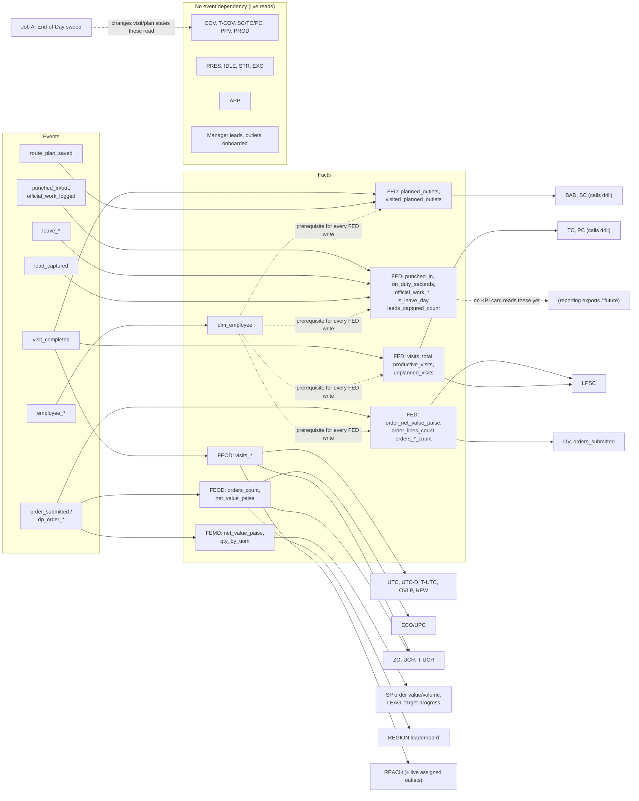

---

## 8. Freshness cheat-sheet

| You do… | Visible in **live** KPIs | Visible in **rollup** KPIs |
| --- | --- | --- |
| Punch in | Immediately (PRES, IDLE) | Next Job B tick (FED punch columns; no card reads them yet) |
| Complete a visit | Immediately (COV, SC/TC/PC, PPV) | Next Job B tick (UTC, LPSC, BAD, calls drill) |
| Place / get approval for an order | — | Next Job B tick (OV, ECO/UPC, ZO, target progress) |
| Day ends (D) | At 00:05 IST on D+1 route states finalise | After sweep **and** the next Job B tick for auto-closed productive visits |
| Sbx vs prod lag | — | **≤ 5 min (sbx)** vs **≤ 6 h (prod)** worst case |

Because SP/Manager dashboards overlay **today's** visits from live routes onto fact history, a lagging projector shows a real `TC` next to a stale `UTC`/`PC` (a skew also noted in the M11 doc §4b).

---

## 9. Findings worth knowing before you trust a number

Verified in code while writing this; none were changed.

1. **M11 doc is stale on one point.** `M11-reporting-and-dashboards.md` §4 says `fact_employee_manufacturer_day` was *removed*. In code the table **exists and is written by `orders_rollup`**, and it **backs order value/volume, the league table and target progress** (`_manufacturer_totals_by_id`, `repository.list_manufacturer_totals`). It is not optional.
2. **Missed visits never reach the fact tables.** Job A marks them `missed` and writes an audit row, but emits no event and `FED.missed_visits` has no writer. Any "missed" figure comes from route tables, not rollups.
3. **Fact columns with no producer (always default/0):** `missed_visits`, `travel_seconds`, `idle_seconds`, `distance_metres`, `orders_edited_on_approval_count`, `orders_submission_failed_count`, `outlets_onboarded_submitted_count`, `outlets_onboarded_verified_count`, `punch_in_location_label`, `first_punch_in_local_time`. `distance_metres` *is* returned by the SP dashboard (always 0).
4. **Sweep audit FK:** `close_day` stamps `RouteMissedVisitAudit.sweep_run_id` with a fresh `generate_ulid()` and discards the real `platform_sweep_runs` id passed to `run_end_of_day_sweep` (`del run_id` in [sweep.py](apps/api/src/humbee_sfa/modules/routes/sweep.py)). So the audit row cannot be joined back to the actual sweep run.
5. **The `TGT`/`T-TGT`/`TGTC` cards never show a number** (`—` / "No target"); achievement shown on targets/league screens comes from a different path (FEMD).
6. **Two events are consumed only as triggers**, not for their payload: `org_*` (re-read current state) and `order_*` (re-read live orders). Event payload fields there are intentionally minimal.
7. **Recovery is manual for quarantine.** Replay is attempted automatically each tick only for `employee_dimension_missing` and `handler_failed` (max 500 each per stream per tick); `beyond_lateness_window` is final.
8. **Sbx vs prod cadence differs by config only** (`application-sbx.yml`: 300 s; base/prod: 21 600 s). `ReportingProjectorWorker`'s own constructor default is 12 h but is never used — `main.py` always passes the configured value.
9. **Not traced:** `admin_coverage_trend`, region-leaderboard district→region mapping, and the `*_export` paths in `reporting/exports.py`. Their dependencies are assumed to be the same fact tables but weren't followed line by line.

---

## 10. Source index

| Topic | File |
| --- | --- |
| Worker startup | [main.py](apps/api/src/humbee_sfa/main.py) |
| Job runner (lock + run claim) | [platform/scheduler.py](apps/api/src/humbee_sfa/platform/scheduler.py) |
| Event publish | [platform/domain_events.py](apps/api/src/humbee_sfa/platform/domain_events.py) |
| Job A | [routes/sweep_worker.py](apps/api/src/humbee_sfa/modules/routes/sweep_worker.py), [routes/sweep.py](apps/api/src/humbee_sfa/modules/routes/sweep.py), `RouteService.close_day` in [routes/service.py](apps/api/src/humbee_sfa/modules/routes/service.py) |
| Job B | [reporting/projector_worker.py](apps/api/src/humbee_sfa/modules/reporting/projector_worker.py), [projector_job.py](apps/api/src/humbee_sfa/modules/reporting/projector_job.py), [projector.py](apps/api/src/humbee_sfa/modules/reporting/projector.py) |
| Producers | [reporting/producers/](apps/api/src/humbee_sfa/modules/reporting/producers/) |
| Dimension | [reporting/dim_employee_sync.py](apps/api/src/humbee_sfa/modules/reporting/dim_employee_sync.py) |
| KPI cards & dashboards | [reporting/service.py](apps/api/src/humbee_sfa/modules/reporting/service.py), [reporting/repository.py](apps/api/src/humbee_sfa/modules/reporting/repository.py) |
| Fact models | [reporting/models/](apps/api/src/humbee_sfa/modules/reporting/models/) |
| Config | [config/application.yml](apps/api/config/application.yml), [application-sbx.yml](apps/api/config/application-sbx.yml) |
